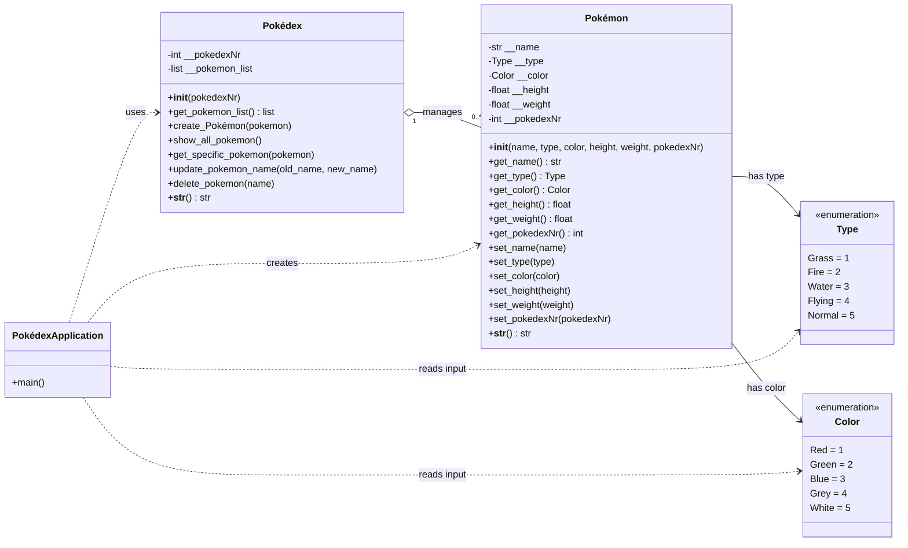

# Pokédex

## Class diagram

The diagram uses ASCII identifiers internally while displaying the project’s
original accented class names. The `Pokédex` collection manages zero or more
Pokémon, while each Pokémon has one `Type` and one `Color`.

